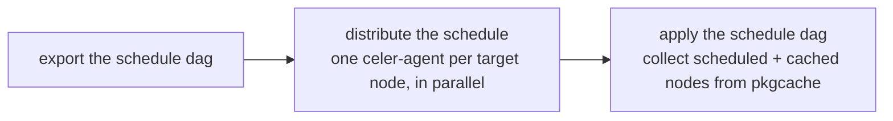

# Distributed build on Jenkins

`celer deploy --export-dag=dag.json` exports the build schedule of the current
project; this directory holds the Jenkins side that turns that schedule into one job
per node, wired by the schedule's own dependency edges, and then collects the artifacts
back with `celer deploy --apply-dag=dag.json`.

The master job also drives a single port: set `CELER_PORT` to a `name@version` to export
and apply with `celer install --export-dag=dag.json <port>` /
`celer install --apply-dag=dag.json <port>`; leave it empty to deploy the whole project.
Everything else (the node jobs, the dependency edges, the pkgcache collection) is
identical.

| File | Jenkins job | Purpose |
|------|-------------|---------|
| `celer-master.groovy` | `celer-master` | Master: exports the schedule, starts each scheduled node once its own dependencies are done, then collects the artifacts. |
| `celer-agent.groovy` | `celer-agent` | Parameterized node job: installs one node of the schedule on its platform's pool. |

## The schedule file

| Field | Use |
|-------|-----|
| `platform` / `project` / `build_type` | Adopted by `celer install --dag` and `celer deploy --apply-dag`: written to the workspace's `celer.toml` before celer is initialized, so the machine builds the schedule's workspace instead of its own. |
| `conf_ref` | The exact conf repo revision (a commit) the schedule was exported from. Both ends need the conf repo, which is why both jobs run `celer init` first: the export records the revision, and `install --dag` / `--apply-dag` reset the workspace's conf to it before reading any port config, so every agent builds on the same configs as the master. A run without the conf repo is refused. |
| `target_nodes[]` | One job per entry, parameter `CELER_PORT`. |
| `target_nodes[].dependencies` | Job edges, but only those that are themselves scheduled: a dependency listed in `cached` is already in pkgcache and needs no edge. |
| `local_nodes[]` | Never a job: every machine builds them locally, the pins in the file keep them reproducible. |
| `cached[]` | Not scheduled: the jobs that need them restore them from pkgcache, and `--apply-dag` collects them too. |
| *(no `target_nodes`)* | Nothing to build: the distribute stage has nothing to start, but the deploy stage still collects `cached[]`. |

## The master job

Export the schedule, fan it out as one node job per target, then apply it back.



| Concern | Behavior |
|---------|----------|
| **Scheduling** | One branch per target node, waiting only for its own dependencies: a slow branch never blocks unrelated nodes. |
| **One builder per node** | A node runs only after its whole dependency closure is in pkgcache, so no two agents build the same node. |
| **Failure** | `parallel` runs with `failFast`: the first node that fails or times out stops the rest. Waiting branches never start; running ones abort their `celer-agent` build (needs Job/Cancel on `celer-agent`, otherwise Jenkins only logs it). |
| **No hang** | `--export-dag` rejects cycles, and a 4-hour `timeout` fails a stuck build through the same `failFast` path. |
| **Reproducibility** | Each node copies exactly the master build's `dag.json`, so a newer schedule cannot leak into a running build. |
| **Apply** | Runs `celer deploy --apply-dag=dag.json` (or `celer install --apply-dag=dag.json <port>`): collects `target_nodes[]` **plus** `cached[]` from pkgcache only, so a node that never reached pkgcache fails the stage instead of being rebuilt there. `local_nodes[]` are built locally. Add `--snapshot=<dir>` for the reproducibility bundle, `--strip` to strip the tree. |

## The node job

| Parameter | Use |
|-----------|-----|
| `CELER_PORT` | `name@version` to install, one entry of `target_nodes`. |
| `CELER_PLATFORM` / `CELER_PROJECT` | The schedule's identity. celer adopts them from `dag.json` itself; they are passed along to describe the build in the job. |
| `MASTER_BUILD` | The `celer-master` build that exported `dag.json`: the node copies exactly that build's file, never a newer one. |

Runs exactly one command:

```shell
celer install --dag=dag.json <name_version>
```

| Concern | Behavior |
|---------|----------|
| **Which agent** | The job asks for the `celer-agent` label; the schedule's `platform` decides what celer builds, not which machine runs the job. |
| **Per-platform pools** | Pass `params.CELER_PLATFORM` into `agent { label ... }` and label agents `celer-agent-<platform>` to split pools per platform. |

## Plugins

- Pipeline (built in).
- Pipeline Utility Steps (`readJSON` in the master job).
- Copy Artifact (`copyArtifacts` in the node job).
- Pipeline: Build Step recent enough that stopping a `build` step aborts the build it
  started (current releases do; the cancel needs Job/Cancel on the downstream job, per
  [SECURITY-3870](https://www.jenkins.io/security/advisory/2026-09-02/)).
- Pipeline: Basic Steps 2.20 or newer: the master waits with `waitUntil(quiet: true)`,
  and the `quiet` option only exists from that release
  ([JENKINS-59776](https://issues.jenkins.io/browse/JENKINS-59776)); without it every
  waiting node would log each check.

Both scripts are plain Declarative Pipeline: create `celer-master` with the content of
`celer-master.groovy` and `celer-agent` with the content of `celer-agent.groovy`. Let
`celer-master` make the first call: it passes `CELER_PORT`, `CELER_PLATFORM`,
`CELER_PROJECT` and `MASTER_BUILD` as build parameters, and `params` reads those
whether or not the node job has registered its own `parameters` block yet. So a
hand-triggered `celer-agent` needs those values typed in, or the parameters defined on
the job first.
