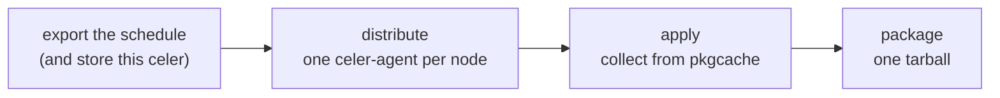

# Distributed build on Jenkins

`celer <mode> --export-dag=dag.json` exports the build schedule; this directory holds the
Jenkins side that turns it into one job per node — wired by the schedule's own dependency
edges — and collects the artifacts back with `--apply-dag=dag.json`.

`CELER_MODE=install` builds just the ports in `CELER_PORTS` (one or more `name@version`, space
or comma separated) instead of the whole project; nothing else changes. `deploy` is the default.

| File | Job | Purpose |
|------|-----|---------|
| `celer-master.groovy` | `celer-master` | Three `celer configure` calls (`--platform`, `--project`, `--build-type`, one flag group per call), export the schedule, wait for each node's dependencies, apply it, then pack `installed/` into one tarball. |
| `celer-agent.groovy` | `celer-agent` | Installs one node: `celer install --apply-dag=dag.json <name_version>`. |

## The schedule file

| Field | Use |
|-------|-----|
| `platform` / `project` / `build_type` | Adopted by `--apply-dag` and written to `celer.toml` before init: every machine builds the schedule's workspace, not its own. |
| `celer_version` | The celer that exported the file. `--apply-dag` re-executes the schedule with that binary, restored from pkgcache. |
| `conf_ref` / `ports_ref` | The local `HEAD` commits the master hashed. `--apply-dag` resets both repos to them, because the configs are part of the build hash. |
| `target_nodes[]` | One job per entry, parameter `CELER_PORT`. |
| `target_nodes[].dependencies` | Job edges; a dependency listed in `cached` is already in pkgcache and needs no edge. |
| `local_nodes[]` | Never a job: built locally, pinned for reproducibility. |
| `cached[]` | Not scheduled: restored by the jobs that need them, collected by `--apply-dag`. |
| *(no `target_nodes`)* | Nothing to build; `--apply-dag` still collects `cached[]`. |

## The master job



- One branch per node, waiting only for its own dependencies: a slow node never blocks
  unrelated ones, and a node starts only once its closure is in pkgcache, so no two agents
  build the same node.
- `failFast`: the first failure or the 4-hour `timeout` stops the rest; running nodes are
  aborted when `celer-agent` grants Job/Cancel.
- Each node copies exactly its master build's `dag.json`, so a newer schedule cannot leak in.
- `--apply-dag` collects `target_nodes[]` and `cached[]` from pkgcache only: in `install` mode
  the apply stage passes `--prefer=pkgcache`, so a node that never reached the cache fails the
  stage instead of being rebuilt on the master. `local_nodes[]` are built locally; add
  `--snapshot=<dir>` or `--strip` as needed.

## The node job

Parameters: `CELER_PORT` (`name@version`), `MASTER_BUILD` (which master build to copy) and
`CELER_PLATFORM`/`CELER_PROJECT` (description only — celer adopts them from the dag).

The node job is the builder: its node is not in pkgcache yet (that is why the schedule
assigned it), so the default chain builds it from source while restoring its dependencies from
the cache. `--prefer=source` would force a rebuild of the node *and* its dependencies.

```shell
celer install --apply-dag=dag.json <name_version>
```

The schedule's `platform` decides what celer builds, not which machine runs it; to split pools,
pass `params.CELER_PLATFORM` into `agent { label ... }` and label agents `celer-agent-<platform>`.

## Pinning the celer binary

`--export-dag` stores the exporting binary as `celers/celer-<os>-<arch>-<version>`;
`--apply-dag` restores it to `<workspace>/tmp/files-*` and `exec`s it, so the `celer` on `PATH`
only bootstraps. Nothing lands in the workspace root and `tmp/files-*` can be deleted freely.

Offline or `CELER_PKGCACHE_WRITABLE=false` stores nothing.

## pkgcache backend

`configurePkgCache()` reads the backend from the master's environment:

| Variable | Use |
|----------|-----|
| `CELER_PKGCACHE_MINIO_HOST` / `_ACCESS_KEY` / `_SECRET_KEY` | minio backend; all three required. |
| `CELER_PKGCACHE_FS_DIR` | fs directory instead (minio wins when both are set). |
| `CELER_PKGCACHE_WRITABLE` | Optional `false` for a read-only cache. |

One is mandatory: the master collects the node artifacts from that cache. Set them on the
`celer-master` node (Nodes → Configure → Node Properties → Environment variables) or globally,
then reconnect the agent. The minio secret ends up on the `celer configure` command line, hence
in the build log.

## Plugins

- Pipeline (built in).
- Active Choices (`uno-choice`): the searchable dropdowns and the reactive `CELER_PORTS`
  multi-select. `CELER_CONF_BRANCH` shells out to `git ls-remote` on every render, so approve
  `confBranchScript()` once in *Manage Jenkins → In-process Script Approval*; the other lists
  are baked in from the previous build (one build behind). `CELER_PORTS_VISIBILITY` hides the
  ports row while deploying with plain CSS. Without the plugin, use `string`/`choice`.
- Pipeline Utility Steps (`readJSON` in the master job: it reads `platform`, `project` and
  `target_nodes[]` from the schedule to create the node jobs).
- Copy Artifact (`copyArtifacts` in the node job).
- Pipeline: Build Step and Pipeline: Basic Steps ≥ 2.20: aborting a running node job, and
  `waitUntil(quiet: true)` ([SECURITY-3870](https://www.jenkins.io/security/advisory/2026-09-02/),
  [JENKINS-59776](https://issues.jenkins.io/browse/JENKINS-59776)).
